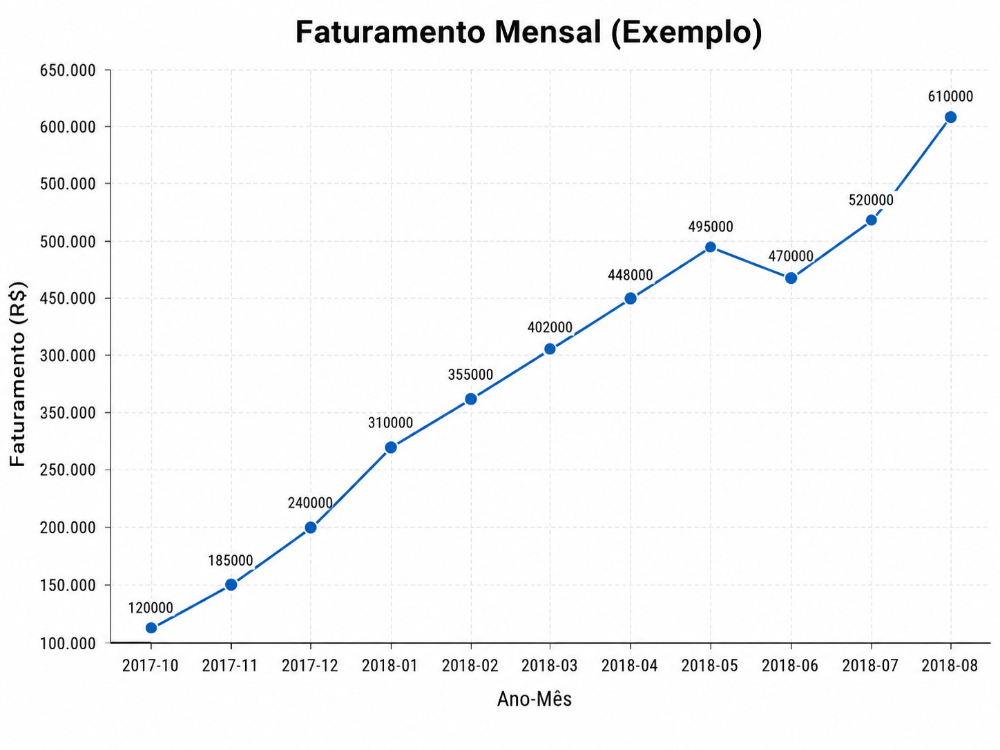
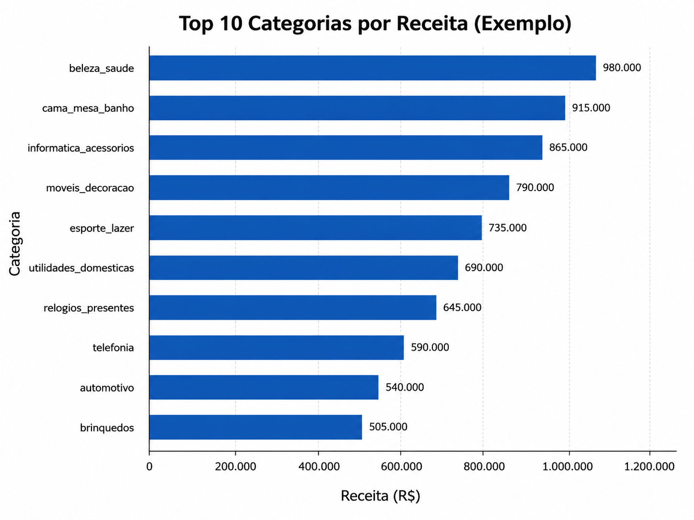
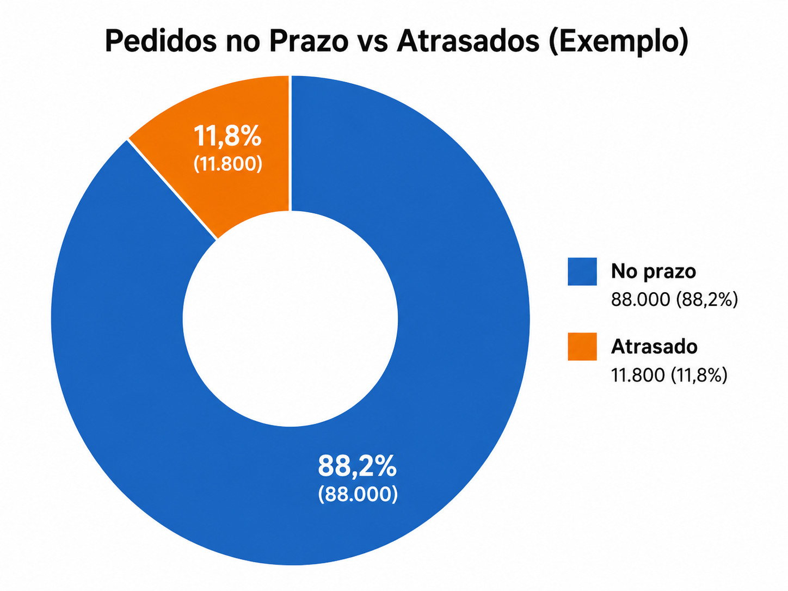
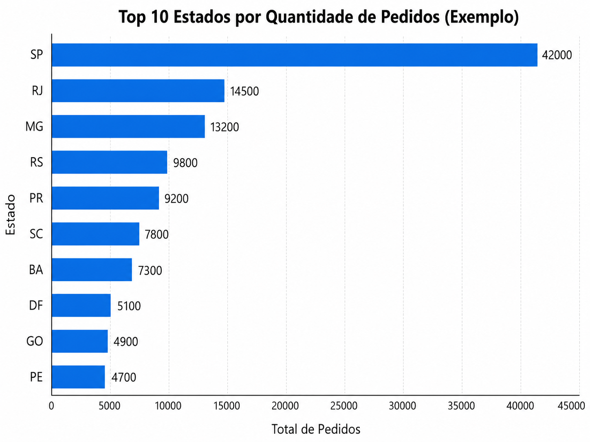

<div align="center">

# 🛒 OLIST | E-COMMERCE ANALYTICS

**SQL · PostgreSQL · Data Quality · Business Analytics**

Análise relacional de vendas, faturamento, frete e desempenho logístico em pedidos da Olist.


[**📂 Consultas exploratórias**](./analise_exploratoria_dados.sql) · [**🧹 Qualidade dos dados e views**](./tratamento_qualidade_Dados.sql)

</div>

---

## 01 / Sobre o projeto

O **Olist E-commerce Analytics** é um estudo de **análise de dados com SQL e PostgreSQL** baseado no *Brazilian E-Commerce Public Dataset by Olist*. O objetivo é transformar informações distribuídas em várias tabelas relacionais em indicadores que ajudem a investigar vendas, categorias, distribuição geográfica, frete e entregas.

**Perguntas de negócio:**
- Como o faturamento e o volume de pedidos evoluem ao longo dos meses?
- Quais categorias e estados concentram maior receita?
- Qual a participação do frete no valor dos produtos?
- Qual a proporção de entregas fora do prazo estimado?
- Quais regiões e vendedores merecem investigação adicional?

> A base representa transações disponibilizadas pela **Olist**, não todo o comércio eletrônico brasileiro.

## 02 / Fluxo de análise

```text
Dataset Olist (CSV)
        ↓
Tabelas relacionais no PostgreSQL
        ↓
Validação: nulos, duplicidade, datas, preços e frete
        ↓
Views SQL para análise
        ↓
KPIs, rankings e séries temporais
        ↓
Gráficos e interpretação de negócio
```

### Relacionamentos principais

```text
olist_orders.customer_id      → olist_customers.customer_id
olist_order_items.order_id    → olist_orders.order_id
olist_order_items.product_id  → olist_products.product_id
olist_order_items.seller_id   → olist_sellers.seller_id
olist_order_payments.order_id → olist_orders.order_id
olist_order_reviews.order_id  → olist_orders.order_id
```

A granularidade é importante: **um pedido pode ter vários itens e pagamentos**. Por isso, totais por pedido exigem agregação adequada para evitar a multiplicação indevida dos valores em joins.

## 03 / Qualidade e preparação dos dados

O script [`tratamento_qualidade_Dados.sql`](./tratamento_qualidade_Dados.sql) contém verificações de:

- Contagem de registros e valores nulos;
- Duplicidades de identificadores em tabelas principais;
- Status e datas inconsistentes;
- Preços e fretes inválidos;
- Produtos sem categoria e avaliações com campos ausentes.

Também são definidas **quatro views** que organizam a exploração:

| View | Finalidade |
|:--|:--|
| `vw_orders_delivered` | Entregas concluídas, tempo de entrega e classificação de atraso |
| `vw_sales_base` | Itens de pedidos entregues, clientes, produtos, vendedores e datas |
| `vw_payments_by_order` | Agregação dos pagamentos por pedido |
| `vw_reviews_base` | Avaliações associadas ao status logístico |

A view `vw_sales_base` filtra **pedidos entregues**. Portanto, os indicadores financeiros construídos sobre ela representam esse recorte, e não necessariamente todos os pedidos criados no dataset.

## 04 / Indicadores de negócio

| Indicador | Definição utilizada |
|:--|:--|
| **Faturamento de produtos** | `SUM(price)` |
| **Frete total** | `SUM(freight_value)` |
| **Valor de itens + frete** | `SUM(price + freight_value)` |
| **Total de pedidos** | `COUNT(DISTINCT order_id)` |
| **Ticket médio de produtos** | `SUM(price) / COUNT(DISTINCT order_id)` |
| **Taxa de atraso** | Pedidos atrasados ÷ pedidos entregues |
| **Tempo médio de entrega** | Média dos dias entre compra e entrega ao cliente |

**Nota sobre pagamentos:** `price + freight_value` é o **valor calculado dos itens e frete**. O valor efetivamente registrado nos pagamentos está em `payment_value`, agregado separadamente pela view `vw_payments_by_order`.

### Exemplo de consulta SQL

Trecho do projeto para obter faturamento, frete e ticket médio:

```sql
SELECT
    COUNT(DISTINCT order_id) AS total_pedidos,
    ROUND(SUM(price)::numeric, 2) AS faturamento_produtos,
    ROUND(SUM(freight_value)::numeric, 2) AS frete_total,
    ROUND(
        SUM(price)::numeric / NULLIF(COUNT(DISTINCT order_id), 0),
        2
    ) AS ticket_medio
FROM vw_sales_base;
```

Veja as demais consultas no arquivo [`analise_exploratoria_dados.sql`](./analise_exploratoria_dados.sql).

## 05 / Visualizações

### 📈 Evolução do faturamento mensal

Acompanhamento do comportamento das vendas ao longo do tempo, útil para identificar sazonalidade e mudanças no volume de negócios.



### 🏷️ Top 10 categorias por receita

Comparação das categorias com maior participação no valor vendido dos produtos.



### 📍 Top 10 estados por pedidos

Distribuição geográfica da demanda com contagem distinta de pedidos.



### 🚚 Entregas no prazo vs. atrasadas

Classificação de entregas pela comparação entre a data efetiva e a data estimada de chegada ao cliente.



## 06 / Aplicações de negócio

| Análise | Possível uso |
|:--|:--|
| **Faturamento + pedidos + ticket médio** | Diferenciar crescimento de demanda e crescimento do valor médio por pedido |
| **Receita por categoria** | Identificar segmentos relevantes para análise comercial |
| **Frete sobre faturamento** | Investigar diferenças de custo relativo entre estados |
| **Atraso por região** | Priorizar a análise de problemas logísticos |
| **Avaliações e entrega** | Explorar associação entre pontualidade e satisfação, quando os dados de reviews estiverem disponíveis |

Essas são **possibilidades de interpretação**, não conclusões causais. Para decisões operacionais, os resultados devem ser confrontados com custos, sazonalidade e outras informações do negócio.

## 07 / Tecnologias e arquivos

**Stack principal:** `PostgreSQL` · `SQL` · `Modelagem relacional` · `Views` · `Análise exploratória` · `Qualidade de dados`

```text
Analise_Dados_OLIST/
├── README.md
├── tratamento_qualidade_Dados.sql
├── analise_exploratoria_dados.sql
├── 6621044c-ab3e-443d-8eee-22e8a595186a.png
├── 8d58e7b1-b710-45d6-8804-aa21672eb080.png
├── 6205d0c8-4182-4dc5-912f-dbfc13575245.png
└── 5baf52b9-5050-4823-8cc6-d9771b7da242.png
```

### Como reproduzir a análise

1. Obtenha o [dataset público da Olist](https://www.kaggle.com/datasets/olistbr/brazilian-ecommerce).
2. Crie o banco PostgreSQL e importe os CSVs nas tabelas esperadas pelos scripts, com prefixo `olist_`.
3. Execute [`tratamento_qualidade_Dados.sql`](./tratamento_qualidade_Dados.sql) para rodar as verificações e criar as views.
4. Execute [`analise_exploratoria_dados.sql`](./analise_exploratoria_dados.sql) para consultar KPIs, categorias, estados e entregas.

**Reprodutibilidade:** o repositório disponibiliza as consultas e visualizações, mas **não contém os CSVs nem scripts de criação/importação das tabelas**. Essas etapas precisam ser preparadas antes de executar os arquivos SQL.

## 08 / Próximos passos

- [ ] Adicionar scripts de criação das tabelas e importação dos CSVs;
- [ ] Publicar uma modelagem relacional visual;
- [ ] Consolidar resultados numéricos das consultas em tabelas reproduzíveis;
- [ ] Construir um dashboard interativo com filtros de período, estado e categoria;
- [ ] Explorar avaliações após confirmar a disponibilidade dos dados correspondentes.

---

<div align="center">

**Cláudio Gardenal** · Data Analytics | SQL | PostgreSQL

[**GitHub**](https://github.com/claudiogardenaldev)

</div>
